<p align="center">
  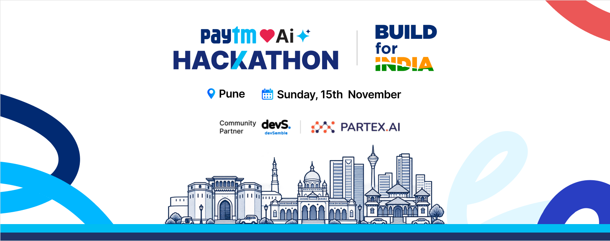
</p>

<p align="center">
  
  &nbsp;&nbsp;&nbsp;&nbsp;
  
</p>

<h1 align="center">LeadPilot</h1>

<p align="center">
  <b>An autonomous AI sales teammate that calls every merchant lead in seconds, talks in Hindi or English, recommends the right Paytm device and books the right field rep.</b>
</p>

<p align="center">
  
  
  
  
  
  
</p>

---

## Team Spaghetti Coders

| | Member |
| :---: | --- |
| 👨‍💻 | **Neel Sonawane** |
| 👩‍💻 | **Sanika Madrewar** |
| 👨‍💻 | **Salil Nilawar** |

---

## Contents

- [The problem](#the-problem)
- [What LeadPilot does](#what-leadpilot-does)
- [A look inside](#a-look-inside)
- [How it works](#how-it-works)
- [How to use it](#how-to-use-it)
- [Roles and permissions](#roles-and-permissions)
- [The intelligence](#the-intelligence)
- [Guardrails and privacy](#guardrails-and-privacy)
- [Impact](#impact)
- [What we used](#what-we-used)
- [Project structure](#project-structure)
- [Pitch deck and template](#pitch-deck-and-template)
- [Roadmap](#roadmap)
- [Notes](#notes)

---

## The problem

A kirana owner asks for a Paytm Soundbox. By the time a sales rep calls back, often one to three days later, a competitor has already installed one. Even after a lead is qualified, field reps lose time on:

- visits booked at the wrong time, or for the wrong device
- merchants who aren't there when the rep arrives
- no briefing before the visit

Meanwhile, nobody notices when a hot lead silently goes cold.

| Today (assumed baseline) | |
| --- | --- |
| Time to first contact | **24–72 hours** |
| Leads that become a field visit | **~15%** |
| Field visits that are wasted | **~20%** |

## What LeadPilot does

LeadPilot is one autonomous teammate that runs the whole path from a new lead to a booked visit, then keeps watching the lead until activation.

1. **Calls within seconds.** It checks consent, DND and calling hours first, then calls. In the demo, your screen rings.
2. **Talks naturally** in Hindi, Hinglish or English, using Sarvam AI speech-to-text, text-to-speech and the `sarvam-105b` language model.
3. **Qualifies the merchant:** shop type, daily sales, current payment setup and location (pincode or area name).
4. **Recommends a device and plan** from a transparent rule table, and scores the lead from 0 to 100 with every point explained.
5. **Picks the right field rep and slot** by distance, coverage, skill, workload and earliest availability, then books the visit.
6. **Briefs the rep and updates the CRM.** It confirms to the merchant on WhatsApp, writes a briefing with likely objections and talking points, and logs a full summary.
7. **Hands off to a human** when it should: discount requests, multi-outlet chains, complaints, an angry merchant, or "let me talk to a manager".
8. **Watches for leakage.** A detector flags leads going cold, and a manager recovers them in one click.

Competitors already have outbound calling bots. These three ideas are what make LeadPilot different:

| 🚨 Lead leakage detection | 🧠 Merchant intelligence | 🗺️ Field-aware allocation |
| --- | --- | --- |
| Finds and recovers leads that are silently going cold | Turns every call into a profile, an explainable score and a rep briefing | Picks the right rep and slot, not just any free slot |

---

## A look inside

### Sign in by role

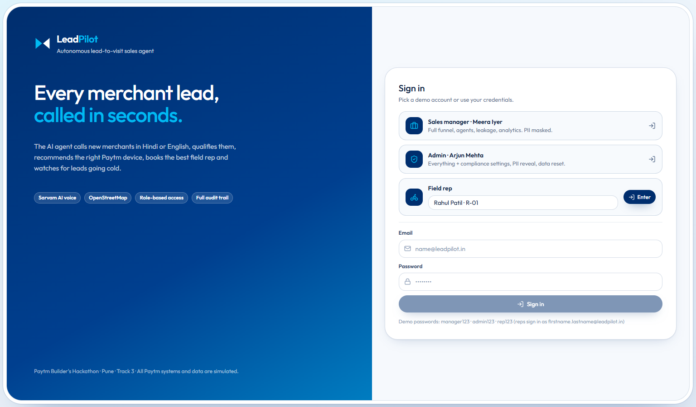

### Overview

The manager's view: lead flow, visit calendar, the AI assistant, lead mix and upcoming visits.

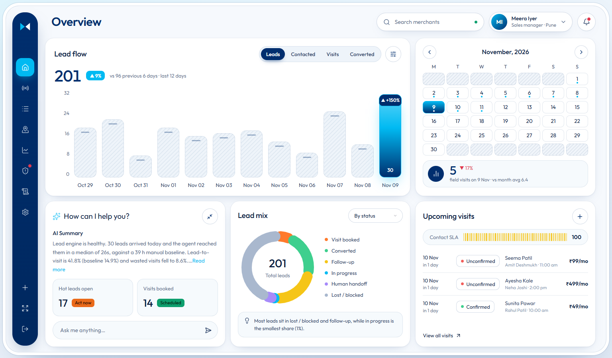

### The AI calls you

Submit a lead and the agent places the call within seconds. You answer and play the merchant.

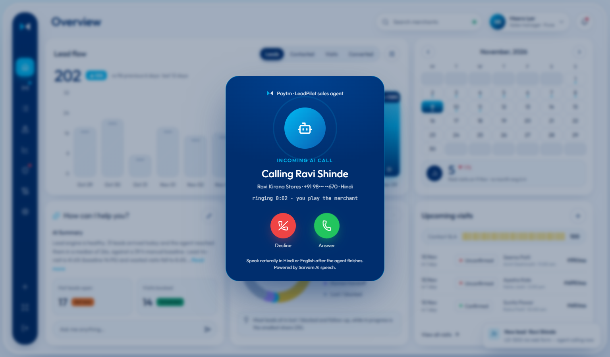

### Live Agent

You can follow the whole call on one screen:

- the transcript in Hindi, with an English translation under every line
- each step of the call as it happens
- the merchant's profile filling in as they speak
- an explainable lead score
- the recommended device and the rep allocation

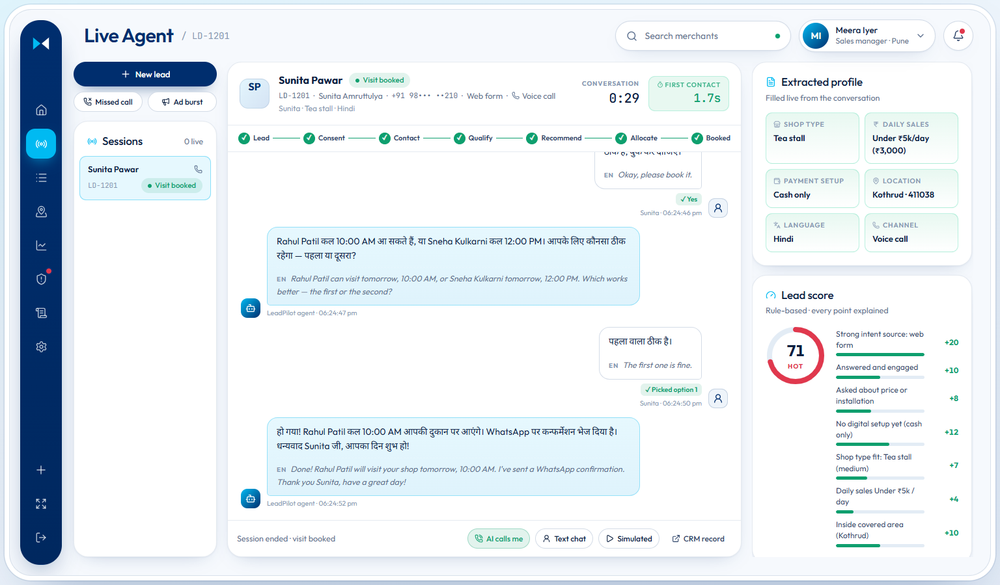

### Merchant record (CRM)

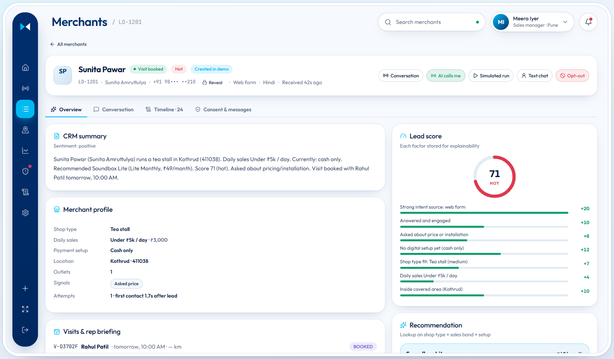

### Merchants

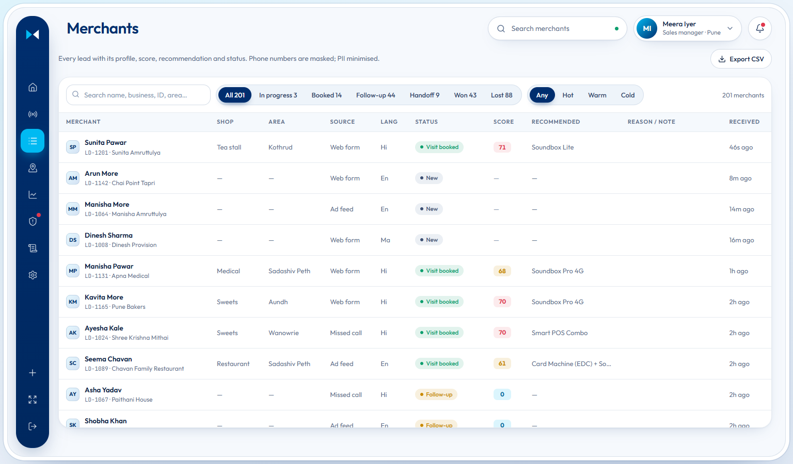

### Field operations on OpenStreetMap

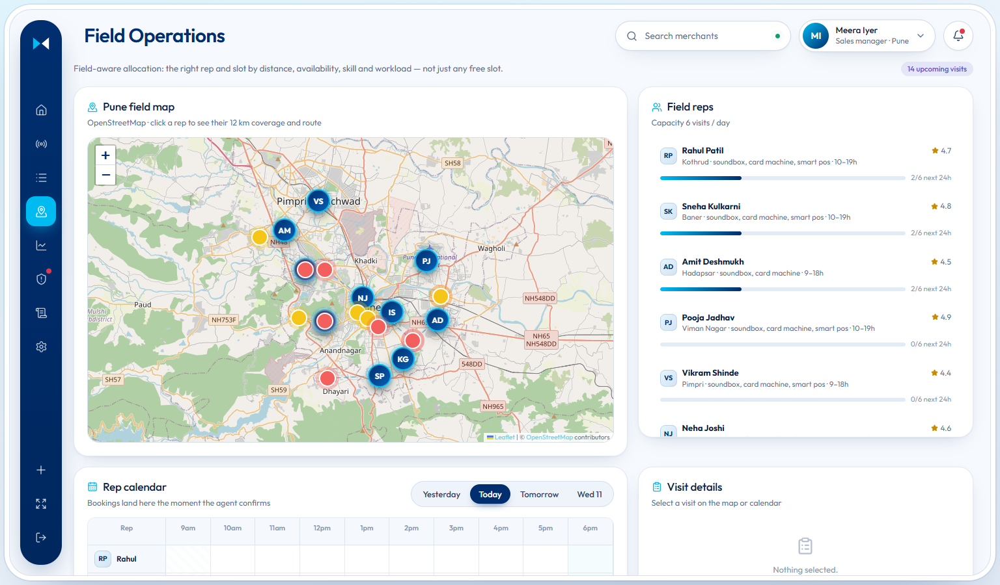

### A field rep's day

Each rep sees only their own merchants, their route on the map, and a briefing before every visit.

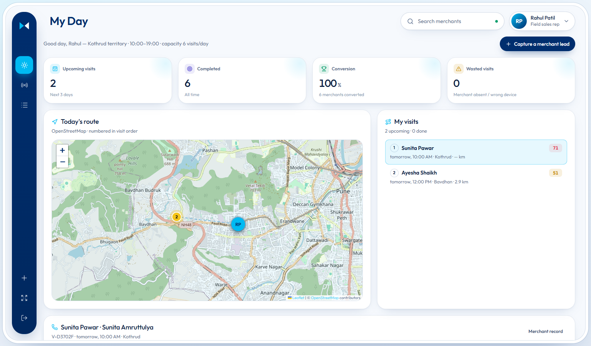

### Lead leakage detector

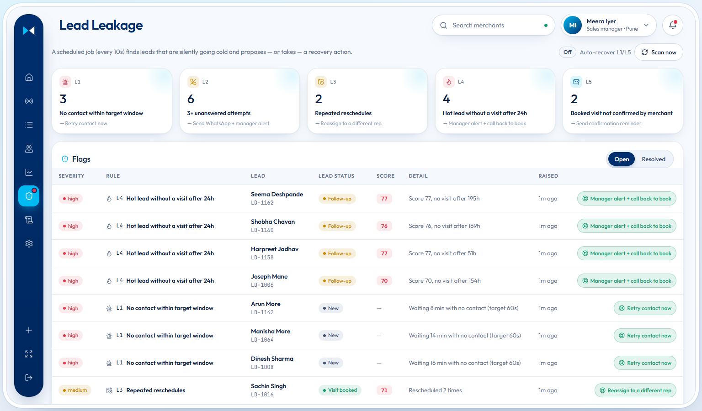

### Analytics: before vs after

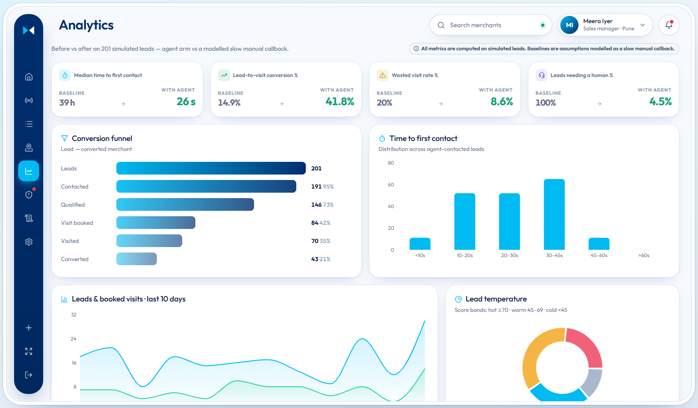

### Audit log

Every tool call is logged, including every Sarvam AI call.

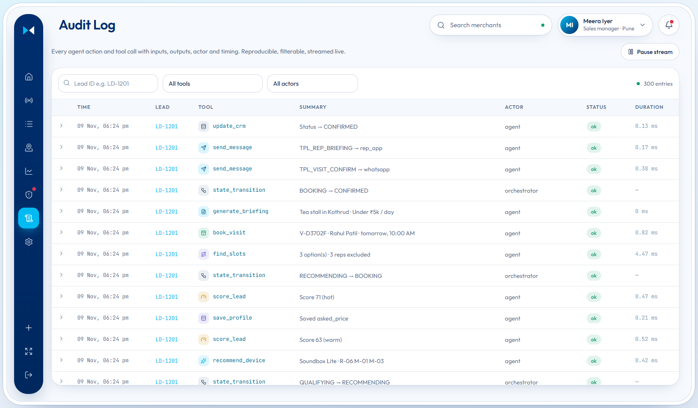

### Compliance and rule tables

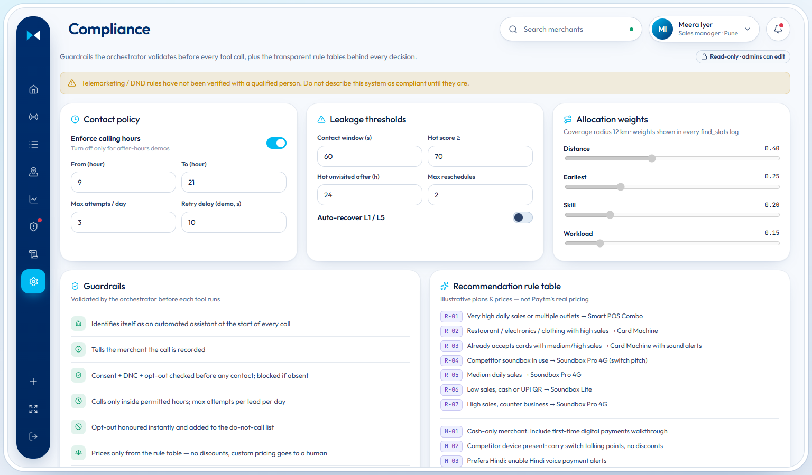

---

## How it works

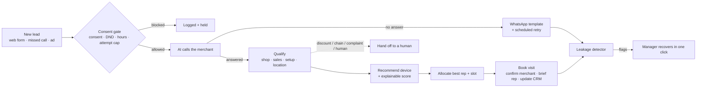

### The live voice loop

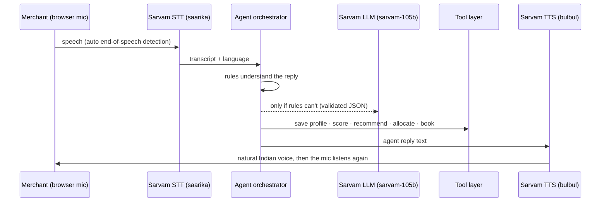

Every tool call is checked against the guardrails before it runs. It is then logged with its inputs, outputs and timing, and streamed live to the dashboard.

---

## How to use it

### Demo accounts

| Role | Email | Password |
| --- | --- | --- |
| Sales manager | `manager@leadpilot.in` | `manager123` |
| Admin | `admin@leadpilot.in` | `admin123` |
| Field rep | `rahul.patil@leadpilot.in` (or any `firstname.lastname@leadpilot.in`) | `rep123` |

### 1. Let the AI call you (manager)

1. Sign in as the **sales manager** and click **+** in the left rail.
2. Keep **"AI calls me (voice)"** selected and submit the lead.
3. Within seconds your screen **rings**. Click **Answer** and allow the microphone.
4. Talk as the merchant after the agent finishes each line. For example:

   | The agent asks | You can say |
   | --- | --- |
   | Is this a good time? | "हाँ जी, बोलिए" / "Yes, go ahead" |
   | What kind of shop? | "मेरी किराना की दुकान है" / "I run a restaurant" |
   | Daily sales? | "रोज़ का बारह हज़ार" / "around 40k a day" |
   | How do customers pay? | "PhonePe QR है" / "only cash" |
   | Pincode or area? | "हडपसर" / "411038" / "Viman Nagar" |
   | Book the demo visit? | "कितना लगेगा?" then "बुक कर दीजिए" |
   | Which slot? | "पहला वाला" / "the second one" |

5. Try the guardrails:
   - **"Discount milega?"** hands the call to a human.
   - **"Mujhe call mat karo"** records the opt-out instantly and adds the number to the do-not-call list.
   - Off-script questions such as **"KYC में क्या लगेगा?"** are answered by Sarvam AI, using only approved facts.

> You can also type replies during a call, or choose **Text chat** instead of voice.

### 2. Watch simulated merchants (manager or admin)

In **Live Agent**, use **Missed call** or **Ad burst**, or pick **Simulated merchant** when creating a lead. Each persona plays out a different scenario, with Sarvam voices on both sides:

| Persona | What it shows |
| --- | --- |
| Sunita · tea stall · Hindi | Low sales, cash only, asks the price, books Soundbox Lite |
| Rakesh · kirana · Hindi | Medium sales, UPI QR, books Soundbox Pro 4G |
| Priya · restaurant · English | High sales, slow bank card machine, books a card machine |
| Vikas · medical · competitor | Has another company's soundbox, hesitant, still books |
| Meena · vegetables · WhatsApp | Misses the call, replies to WhatsApp, booked within a minute |
| Deepak · voice fails | Telephony fails, the agent switches to chat and books |
| Anil · six-outlet chain | Asks for a bulk discount, handed to a human |
| Raj · opts out | Instant opt-out and do-not-call entry |
| Ghost lead | Never answers, hits the attempt cap, flagged as leakage |

### 3. Run the operation (manager)

- **Overview:** lead flow, visit calendar, lead mix, upcoming visits. Ask the assistant things like *"Which rep converts best?"*
- **Field Operations:** each rep's coverage and routes on OpenStreetMap, the rep calendar and visit briefings. Record outcomes, or reassign a visit when a rep is unavailable.
- **Lead Leakage:** flags leads going cold; **Recover** fixes each one in one click.
- **Analytics:** before/after comparison, funnel, lost-deal reasons, rep performance.
- **Audit Log:** every action with its inputs and outputs.

### 4. Work in the field (field rep)

Sign in as **Rahul Patil**. The **My Day** screen shows:

- today's route on the map
- each visit's briefing: profile, recommended device, likely objections, talking points
- buttons to record **Converted / Revisit / Rejected**, or **I'm unavailable — reassign**

Reps can also capture a new merchant and let the AI call. Manager screens are locked for reps, and the server enforces this too.

### 5. Govern (admin)

Sign in as **admin** to:

- edit compliance rules: calling hours, attempt cap, leakage thresholds, allocation weights
- reveal a masked phone number (the reveal is audited)
- reset the demo data

---

## Roles and permissions

These checks run on the server for every request, not just in the screens. Sign-in tokens are signed and expire after 12 hours.

| Capability | Field rep | Manager | Admin |
| --- | :---: | :---: | :---: |
| My Day route, own visits, visit outcomes | ✅ | ✅ | ✅ |
| See all merchants and visits | own only | ✅ | ✅ |
| Create leads, talk to the AI agent | ✅ | ✅ | ✅ |
| Simulated merchants, missed call, ad burst | — | ✅ | ✅ |
| Overview, analytics, assistant | — | ✅ | ✅ |
| Lead leakage and recovery, human handoffs | — | ✅ | ✅ |
| Audit log | — | ✅ | ✅ |
| View compliance rules | — | ✅ | ✅ |
| Edit compliance rules | — | — | ✅ |
| Reveal phone numbers (audited) | — | — | ✅ |
| Reset demo data | — | — | ✅ |

---

## The intelligence

### Lead score (0–100)

Every factor and its points are stored, so the dashboard can explain any score.

| Factor | Points |
| --- | --- |
| Source: web form / missed call / ad | +20 / +14 / +8 |
| Answered and engaged | +10 |
| Asked about price or installation | +8 |
| Cash only / UPI QR only / has a card machine | +12 / +6 / +3 |
| Competitor device in use | −8 |
| Shop fit: high / medium / low | +12 / +7 / +3 |
| Daily sales: low / medium / high / very high | +4 / +10 / +15 / +18 |
| Inside / outside field coverage | +10 / −10 |
| Hesitation on the call | −6 |
| Each unanswered attempt | −5 |

**Hot** is 70 or more, **warm** is 45–69, and **cold** is below 45.

### Device recommendation

The device comes from a rule table on shop type × daily sales × payment setup. Prices are illustrative.

| Device | Plan | When |
| --- | --- | --- |
| Soundbox Lite | ₹49/month | Low sales, cash or UPI QR |
| Soundbox Pro 4G | ₹99/month | Medium sales, or a competitor soundbox (switch pitch) |
| Card Machine + Soundbox | ₹299/month | Restaurant, electronics or clothing with high sales, or already accepts cards |
| Smart POS Combo | ₹499/month | Very high sales or multiple outlets |

### Field-rep allocation

First, every rep must pass these checks:

- the rep covers the area (within 12 km)
- the rep has the skill for the recommended device
- the rep works that slot
- the rep still has capacity that day

Eligible reps are then ranked by **distance 0.40 · earliest slot 0.25 · skill 0.20 · workload 0.15**. Admins can change these weights.

### Lead leakage rules

| Rule | Detects | Action |
| --- | --- | --- |
| L1 | No contact within the target window | Retry contact now |
| L2 | 3+ unanswered attempts | WhatsApp nudge + manager alert, retry tomorrow |
| L3 | Repeated reschedules | Reassign to a different rep |
| L4 | Hot lead with no visit after 24 h | Manager alert + call back to book |
| L5 | Booked visit not confirmed | Send a confirmation reminder |

---

## Guardrails and privacy

- The agent says it is an automated assistant, and that the call is recorded, at the start of every call.
- **Consent gate:** there is no contact without consent, inside permitted hours, and within the daily attempt cap.
- An opt-out is honoured instantly and the number is added to the do-not-call list.
- Prices come only from the rule table. There are no discounts; custom pricing goes to a human.
- The Sarvam language model is a fallback for understanding only. Its output is checked against allowed values before it can change anything. It may answer questions only from approved facts, and must never invent numbers.
- Messages are sent only through approved WhatsApp and SMS templates.
- Phone numbers are stored as a keyed hash for lookup and encrypted for dialling, and are masked everywhere. Revealing one is admin-only and audited.
- The Sarvam API key stays on the server and is never sent to the browser.

> Telemarketing and DND rules have not yet been verified by a qualified person. We don't describe LeadPilot as compliant until they are.

---

## Impact

These results come from 200 simulated leads, compared with a modelled slow manual callback. The baselines are assumptions to be replaced with Paytm data.

| Metric | Manual baseline | With LeadPilot |
| --- | :---: | :---: |
| Median time to first contact | ~39 hours | **~26 seconds** |
| Lead-to-visit conversion | ~15% | **~40%** |
| Wasted field visits | ~20% | **~9%** |
| Leads that needed a human | 100% | **~5%** |

These timings were measured against the live Sarvam API during testing:

| Sarvam step | Time |
| --- | --- |
| Speech-to-text | about 1.1 s |
| Language-model understanding | about 0.6 s |
| Text-to-speech | about 1.8 s |

---

## What we used

| Area | Technology |
| --- | --- |
| **Speech-to-text** | Sarvam AI `saarika:v2.5`, Hindi and English with automatic language detection |
| **Text-to-speech** | Sarvam AI `bulbul:v3`: a female agent voice and male or female merchant voices |
| **Language model** | Sarvam AI `sarvam-105b`: understanding fallback, off-script answers, analytics assistant |
| **Translation** | Sarvam AI translate, for the English lines under the Hindi transcript |
| **Agent and API** | Python, FastAPI, asyncio state-machine orchestrator, `httpx` |
| **Data** | SQLite, with 200 deterministic simulated leads and 10 Pune field reps |
| **Live updates** | Server-sent events |
| **Access control** | Signed stateless tokens (HMAC-SHA256) and a server-side permission matrix |
| **Dashboard** | React 18, Vite, Recharts, Lucide icons, Paytm navy and cyan light theme |
| **Maps** | OpenStreetMap tiles with Leaflet / react-leaflet |
| **Voice in the browser** | Web Audio mic capture, automatic end-of-speech detection, 16 kHz WAV encoding, playback queue |
| **Standalone app** | `LeadPilot.html`, the whole dashboard in one file (vite-plugin-singlefile) |
| **Packaging** | Docker, Render blueprint |
| **Pitch deck** | PptxGenJS, Pillow, PowerPoint (for rendering and QA) |

---

## Project structure

```
├── backend/                FastAPI agent + API
│   ├── main.py             routes, live event stream, voice endpoints, RBAC guards
│   ├── agent.py            guarded state-machine orchestrator (voice, chat, simulated)
│   ├── sarvam.py           Sarvam STT / TTS / LLM / translate client
│   ├── auth.py             users, signed tokens, permission matrix, rep ownership
│   ├── nlu.py              Hindi / Hinglish / English understanding, spoken numbers, Pune areas
│   ├── rules.py            recommendation, scoring and allocation rules
│   ├── tools.py            logged tool layer (consent, call, book, CRM, messages…)
│   ├── leakage.py          lead leakage detector + recovery
│   ├── metrics.py          funnel, before/after, calendar, rep performance
│   └── seed.py             simulated leads, reps and baseline arm
├── frontend/               React dashboard
│   └── src/
│       ├── pages/          Overview, Live Agent, CRM, Field Ops, My Day, Analytics, Leakage, Audit, Compliance
│       ├── components/     incoming call, OpenStreetMap, new-lead modal, UI kit
│       ├── voice.js        real-time voice engine
│       └── light.css       Paytm light theme
├── LeadPilot.html          the whole dashboard as one file
├── presentation/           pitch deck + PARAM-style blank template
└── docs/images/            screenshots and logos used in this README
```

---

## Pitch deck and template

- [`presentation/Paytm-AI-Hackathon-LeadPilot.pptx`](presentation/Paytm-AI-Hackathon-LeadPilot.pptx): a 15-slide, fully editable pitch deck with speaker notes.
- [`presentation/template/Hackathon-Template-PARAM-Light.potx`](presentation/template/Hackathon-Template-PARAM-Light.potx): a blank template in the PARAM Shavak light style with 11 layouts, carrying only the hackathon logo.

---

## Roadmap

| Phase | Focus |
| --- | --- |
| **Today: hackathon MVP** | Voice agent, scoring, allocation, leakage detector, role-based access |
| **Pilot** | Real telephony (e.g. Exotel), WhatsApp Business templates, Paytm CRM integration |
| **Scale** | Scoring models trained on real outcomes, route grouping, Marathi |
| **Vision** | Predictive acquisition, territory heatmaps, a pitch that learns over time |

---

## Notes

- All Paytm systems, merchants, field reps and metrics in this prototype are **simulated**, and the prices are illustrative.
- In the prototype the agent "calls" the dashboard user in the browser. Calling real phone numbers would need a telephony provider.
- The product requirements and architecture are in [`Lead-to-Visit Sales Agent RD, PRD and Architecture.md`](Lead-to-Visit%20Sales%20Agent%20RD,%20PRD%20and%20Architecture.md).
- Paytm, the Paytm AI Hackathon logo and Build for India are the property of their respective owners and are used here for the hackathon submission.

<p align="center"><b>Built with ❤️ in Pune by Team Spaghetti Coders</b><br>Neel Sonawane · Sanika Madrewar · Salil Nilawar</p>
